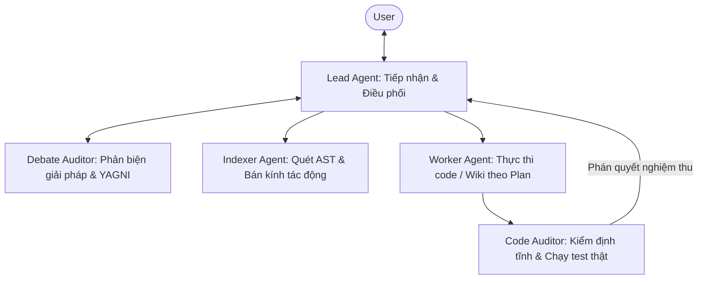

# template-antigravity-agent-rule

Bộ rule điều phối multi-agent cho Google Antigravity, tối ưu hóa hạn mức (quota) lớn của các model nhanh bằng cách tự động hóa quy trình phản biện thiết kế và kiểm định kiến trúc.

---

## 1. Vấn Đề Kỹ Thuật

Trong Antigravity, model nhẹ (`Gemini 3.8 Flash`) có lượng quota rất lớn trong mỗi chu kỳ 5 giờ và viết code tốt khi kế hoạch (`Plan`) đã rõ ràng. Tuy nhiên, nút thắt nằm ở **năng lực lý luận và thiết kế hệ thống**:

- **Thiết kế ngây thơ, dễ vỡ:** Đưa ra giải pháp thiếu chiều sâu, mâu thuẫn logic, vi phạm YAGNI hoặc phá vỡ các ràng buộc sẵn có của kiến trúc hiện tại.
- **Tổn thất kép cho người dùng:**
  1. **Mất thời gian:** Phải liên tục đóng vai Senior/Architect để bóc tách, uốn nắn và phản biện các lỗi thiết kế qua nhiều lượt chat.
  2. **Lãng phí quota:** Quota dồi dào trong cửa sổ 5 giờ trôi qua vô ích trong lúc người dùng phải dừng lại phân tích và giải thích lỗi cho AI.

---

## 2. Giải Pháp: Tách Rời Khâu Lý Luận Và Khâu Thực Thi

Hệ thống tận dụng lượng quota dồi dào của chu kỳ để các agent tự phản biện và hoàn thiện thiết kế trước khi viết code:

1. **Thẩm định tư duy & giải pháp (`Debate Auditor`):**
   - Trước khi gửi kế hoạch cho User, `Debate Auditor` độc lập mổ xẻ dự thảo của `Lead Agent`: phát hiện mâu thuẫn kiến trúc, bóc tách thiên kiến và rủi ro phá vỡ ràng buộc (ghi biên bản tại `.agents/DEBATE_LOG.md`).
   - Có thể gán model suy luận mạnh hơn (`Claude 3.7 / 3.5 Sonnet` hoặc `Gemini 4 Argon`) cho vai trò này để nâng chất lượng phản biện.
2. **Khóa ranh giới tác động bằng AST (`Indexer Agent`):**
   - Quét đồ thị gọi hàm (`GitNexus` / `ripgrep`) để khóa đúng bán kính tác động (`Blast Radius`), ngăn chặn code mới phá vỡ hợp đồng của các module dùng chung (`[CORE]`, `[SHARED]`).
3. **Thực thi tập trung (`Worker Agent` chạy Flash):**
   - Khi kế hoạch đã được phản biện chặt chẽ và phạm vi file đã khóa cứng, `Worker` chạy trên `flash` phát huy tối đa thế mạnh: viết code nhanh, chính xác theo spec mà không lan man.
4. **Kiểm định thực chứng (`Code Auditor`):**
   - Độc lập kiểm tra tĩnh và chạy test đối kháng trên môi trường thật để nghiệm thu code của Worker trước khi báo hoàn tất.

**Bản chất đánh đổi:** Chấp nhận tốn thêm token và thời gian suy luận để nhận phương án kỹ thuật chắc chắn hơn, sàng lọc bớt các sai sót ngây thơ và giảm đáng kể công sức phản biện thủ công của người dùng.

---

## 3. Đánh Đổi Về Quota & Phạm Vi Phù Hợp

- **Tiêu thụ token trên mỗi turn cao hơn:** Một yêu cầu thiết kế/tính năng sẽ kích hoạt 2–4 lượt trao đổi ngầm giữa các subagent.
- **Nên dùng khi:**
  - Dự án có kiến trúc nhiều tầng, cần ra quyết định kỹ thuật cẩn trọng và muốn AI tự tranh luận để đưa ra phương án tối ưu.
  - Tận dụng lượng quota dồi dào trong chu kỳ 5 giờ của Flash để đổi lấy phương án chắc chắn hơn, giảm bớt công sức phản biện lặp đi lặp lại.
- **Không nên dùng khi:**
  - Cần tiết kiệm hạn mức của các model cao cấp (`Claude`, `Pro`) khi các model này sắp chạm giới hạn chu kỳ.
  - Tác vụ thuần tra cứu cú pháp đơn giản, không cần đánh giá kiến trúc.

---

## 4. Kiến Trúc Điều Phối 5 Vai Trò



| Vai trò              | Trách nhiệm chính theo góc nhìn hệ thống                                            | Model khuyến nghị       |
| :------------------- | :---------------------------------------------------------------------------------- | :---------------------- |
| **`Lead Agent`**     | Trao đổi với User, đề xuất giải pháp ban đầu, điều phối subagent.                   | Model chọn trên UI chat |
| **`Debate Auditor`** | Phản biện giải pháp kỹ thuật và kế hoạch; tìm điểm mù, thiên kiến và vi phạm YAGNI. | `inherit` hoặc `pro`    |
| **`Indexer Agent`**  | Phân tích AST, xác định callers và bán kính tác động (`Blast Radius`).              | `flash`                 |
| **`Worker Agent`**   | Thực thi code/tài liệu theo kế hoạch đã chốt; tuân thủ quyền ghi độc quyền.         | `flash`                 |
| **`Code Auditor`**   | Kiểm định tính toàn vẹn của code và chạy test đối kháng trên môi trường thật.       | `inherit` hoặc `pro`    |

---

## 5. Cấu Hình Model Cho Subagent (`.agents/MODEL_CONFIG.yaml`)

Tại Turn 1, `Lead Agent` tự động kiểm tra và khởi tạo file `.agents/MODEL_CONFIG.yaml` từ bản mẫu `.template.yaml`:

- `inherit`: Kế thừa 100% model và mức reasoning đang chọn trên UI chính (khuyên dùng cho `Debate Auditor` và `Code Auditor`).
- `pro`: Cố định `Gemini 4 Argon Medium`.
- `flash`: Cố định `Gemini 3.8 Flash Medium` (khuyên dùng cho `Worker` và `Indexer`).
- `flash_lite`: Bản Flash siêu nhẹ.

_(Lưu ý: Mọi tier khác `inherit` đều bị khóa mức reasoning ở Medium)._

---

## 6. Cài Đặt Vào Dự Án

Chạy lệnh tại thư mục gốc dự án (sử dụng `degit` để chép tệp mà không ảnh hưởng lịch sử Git):

```powershell
# Windows (PowerShell)
npx.cmd degit Mtdung290504/template-antigravity-agent-rule . --force
```

```bash
# macOS / Linux
npx degit Mtdung290504/template-antigravity-agent-rule . --force
```

- Quy chuẩn chi tiết: xem [`AGENTS.md`](AGENTS.md).
- Hướng dẫn xử lý khi dự án đã có sẵn thư mục `.agents/`: xem [`how-to-add-to-your-project.md`](how-to-add-to-your-project.md).
